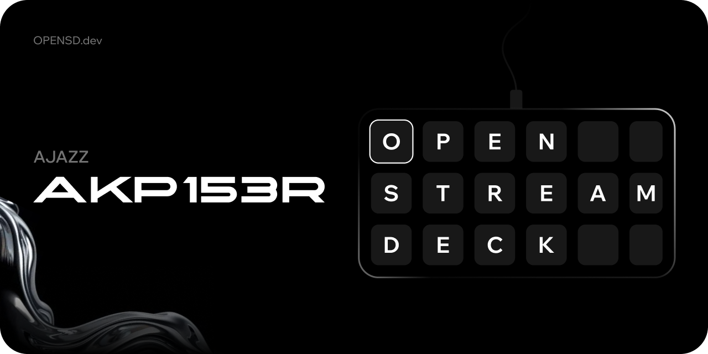

# AJAZZ AKP153R Firmware

Прошивка AJAZZ AKP153R для Open Stream Deck: 15 кнопок, USB HID Full Speed/High Speed, дисплей 480 x 854, RGB565 через SPI и DMA. Поддерживает передачу изображений, графические примитивы, копирование видеопамяти, управление яркостью и ожидание кадровой синхронизации панели. Полноэкранный поток изображений идёт со скоростью около 3,8 МБ/с.

Устройство определяется как `OSD AKP153R`, USB `1209:0001`, serial `OSD153R00001`. Протокол: OSD1 v1.

Подходит только для AKP153R первой ревизии, со штатной прошивкой она видна как USB `0300:1020`. AKP153R rev. 2 (`0300:3011`) построена на другом железе и не поддерживается. Деки других брендов на той же плате перечислены в [Firmware-Requests](https://github.com/Open-Stream-Deck/Firmware-Requests#вероятно-совместимые-деки).

После заставки любая кнопка запускает мини-игру. Следующие нажатия выполняют прыжок, после столкновения начинают новую попытку. Первый кадр приложения завершает игру. Рекорд хранится до отключения питания.

## Как прошить

1. Установите [Open Stream Deck](https://github.com/Open-Stream-Deck/Open-Stream-Deck-App/releases/latest) для Windows, macOS или Linux.
2. Скачайте `AjazzAKP153R-vX.Y.Z.bin` из [последнего релиза прошивки](https://github.com/Open-Stream-Deck/Firmware-AjazzAKP153R/releases/latest). Остальные файлы релиза нужны только для отладки.
3. Подключите деку напрямую к компьютеру, без хабов и удлинителей, и закройте программу AJAZZ, если она запущена.
4. В Open Stream Deck откройте «Настройки», «Прошивка», нажмите «Выбрать файл», укажите скачанный BIN и нажмите «Установить».
5. Когда приложение попросит, отключите и снова подключите USB. Дека покажет заставку Open Stream Deck, и приложение подключится к ней само.

Шить можно поверх штатной прошивки AJAZZ и поверх любой версии Open Stream Deck, обновление ставится так же. Не отключайте деку, пока идёт запись. Если запись всё же прервалась, повторите её: загрузчик деки не перезаписывается, и она останется в режиме прошивки.

Вернуть штатную прошивку можно тем же способом, выбрав BIN от AJAZZ. Подробнее про установку и загрузчик: [вики](https://wiki.opensd.dev/docs/firmware/install), [docs/UPDATE.md](docs/UPDATE.md).


## Сборка

Клонируйте репозиторий по URL из меню GitHub Code и перейдите в его каталог.

В Ubuntu 24.04 или WSL установите зависимости:

```bash
sudo apt update
sudo apt install gcc-arm-none-eabi binutils-arm-none-eabi gcc python3
bash test.sh
bash build.sh
```

Для обычной сборки Python-пакеты, SDK производителя и исходники приложения не нужны. Готовые буквы заставки включены в репозиторий.

В Windows нужен WSL с установленными зависимостями. Из PowerShell:

```powershell
.\build.ps1 -Test
```

По умолчанию используется `Ubuntu-24.04`. Другой установленный дистрибутив задаётся параметром `-Distribution`.

| Файл | Назначение |
| --- | --- |
| `build/AjazzAKP153R-v1.0.0.bin` | Образ приложения |
| `build/firmware.json` | Версия, размер, SHA256, CRC16 и адреса |
| `build/AjazzAKP153R-v1.0.0.elf` | ELF с отладочной информацией |
| `build/AjazzAKP153R-v1.0.0.map` | Карта размещения |

Версия в именах файлов берётся из `tools/version.py`; здесь показан пример для `1.0.0`. `firmware.json` содержит точное имя BIN-файла в поле `file`. Сборка не записывает прошивку в устройство. Каталог `build/` исключён из Git.

### Запись из PowerShell

Для записи без интерфейса нужен отдельно клонированный [Open Stream Deck](https://github.com/Open-Stream-Deck/Open-Stream-Deck-App) с настроенной средой сборки Rust/Tauri по инструкции приложения:

```powershell
.\flash.ps1 -AppPath 'C:\projects\open-stream-deck-app\src-tauri'
.\flash.ps1 -AppPath 'C:\projects\open-stream-deck-app\src-tauri' -Flash
```

Первая команда проверяет образ и выводит параметры, вторая записывает его. Подробности: [обновление и загрузчик](docs/UPDATE.md).

## Разработка

- [Разработка, сборка и тесты](docs/DEVELOPMENT.md)
- [USB-протокол](docs/PROTOCOL.md)
- [Аппаратная часть и память](docs/HARDWARE.md)
- [Обновление прошивки](docs/UPDATE.md)

Координаты кнопок и боковой области находятся в `layout.json`.

## Лицензия

Исходники доступны по [Open Stream Deck Noncommercial License 1.0](LICENSE). 

Некоммерческое использование, изменение и распространение разрешены с обязательным указанием автора и сохранением лицензии. 

Коммерческое использование, включая продажу устройств с этой прошивкой, требует отдельной письменной лицензии от автора: [ceo@lisik.dev](mailto:ceo@lisik.dev).
